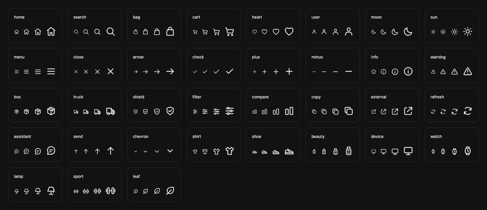

# AnoX icon system — owner review

A presentation-only update from production baseline `0ce6c538a333bf12028500649294580fae4e3509`, on `design/anox-icon-system-20261019`. The 24 shared symbols and three separate assistant SVG implementations now use one original 35-glyph family. Category selectors gain distinct silhouettes; hearts, header actions and dialog controls gain restrained depth and clearer states.

## Inspect the result

Run `python3 -m http.server 8786 --bind 127.0.0.1` from the repository, then open `http://127.0.0.1:8786/docs/design/preview.html`. Open the review path directly; the ordinary storefront root still contains its production API configuration.

The [interactive review](preview.html) has 60 before/after combinations (15 screens × four widths), a keyboard-operable comparison slider, the actual renderer at 16/20/24/32px, light/dark themes, and interactive saved/disabled/focus examples. It cannot connect to APIs. Its screenshots use synthetic, labeled product art and a synthetic account. They are visual fixtures, **not live-provider or commercial evidence**.

| View | Released baseline | Icon candidate |
| --- | --- | --- |
| Desktop search | [Before](evidence/before/chromium-desktop-search.png) | [After](evidence/after/chromium-desktop-search.png) |
| Mobile favorites | [Before](evidence/before/chromium-mobile-shop-saved.png) | [After](evidence/after/chromium-mobile-shop-saved.png) |
| 320px category menu | [Before](evidence/before/chromium-narrow-menu-expanded.png) | [After](evidence/after/chromium-narrow-menu-expanded.png) |
| Light theme | [Before](evidence/before/chromium-mobile-home-light.png) | [After](evidence/after/chromium-mobile-home-light.png) |
| Product actions | [Before](evidence/before/chromium-mobile-product-actions.png) | [After](evidence/after/chromium-mobile-product-actions.png) |
| Keyboard focus | [Before](evidence/before/chromium-desktop-home-keyboard-focus.png) | [After](evidence/after/chromium-desktop-home-keyboard-focus.png) |
| Pressed state | [Before](evidence/before/chromium-mobile-shop-pressed.png) | [After](evidence/after/chromium-mobile-shop-pressed.png) |
| Disabled controls | [Before](evidence/before/chromium-mobile-cart-disabled.png) | [After](evidence/after/chromium-mobile-cart-disabled.png) |

## Design and scope

- One 24-point grid, rounded 1.75-unit strokes, balanced interior space and `currentColor`. Original artwork and renderer/style assets have an explicit [MIT license](../../LICENSE-icons.txt). No restricted Apple assets, icon fonts, external icon requests or new runtime dependencies.
- Glass effects apply to small controls: a restrained gradient, inset highlight, border and shallow shadow. Only the 44px product-heart overlay uses an 8px backdrop blur; opaque and reduced-transparency fallbacks remain available. Product/content surfaces retain their design.
- The shared renderer replaces the assistant's separate grids/strokes, filter-chip ×, comparison ✓/+, and category caret/disclosure inconsistencies. Existing labels, action selectors, state attributes, routes and event behavior are preserved. Text-led account, authentication, service-request, order and tracking controls remain text-led.
- The theme utility row grows from 30px to 44px for its touch target; mobile header action targets are at least 44px. This small spacing change is intentional. The logo, fonts, page architecture and product-card structure are unchanged.
- Keyboard focus, selected-heart fill plus color, decorative SVG semantics, localized accessible names, forced-color and reduced-motion alternatives are retained or improved. The target-size choice exceeds the [WCAG 2.2 AA minimum](https://www.w3.org/WAI/WCAG22/Understanding/target-size-minimum.html); contrast checks use the [3:1 non-text threshold](https://www.w3.org/WAI/WCAG22/Understanding/non-text-contrast.html). This is focused icon/control verification, not a claim of a whole-site accessibility certification.

Exact glyph inventory: `home`, `search`, `bag`, `cart`, `heart`, `user`, `moon`, `sun`, `menu`, `close`, `arrow`, `check`, `plus`, `minus`, `info`, `warning`, `box`, `truck`, `shield`, `filter`, `compare`, `copy`, `external`, `refresh`, `assistant`, `send`, `chevron`, `shirt`, `shoe`, `beauty`, `device`, `watch`, `lamp`, `sport`, `leaf`. The eight category mappings and full baseline audit are in [icon-system.md](icon-system.md).

## Visual review and corrections

Both a primary and an independent reviewer inspected real Chromium/Firefox screenshots. Review included both 35-glyph atlases, desktop search, expanded 320px menus, mobile selected hearts, light theme, Arabic/RTL search and navigation, assistant controls, product actions and account/order presentations.

The implementation corrected four observed CSS conflicts before final evidence: a high-specificity dark-home rule obscured hearts; another dark-theme rule overrode the selected background; utility styles retained a 30px theme target; and open mobile categories displayed both the old pseudo-element minus and the new chevron. Final screenshots show distinct heart states, one disclosure indicator, aligned category symbols and visible focus rings. No remaining substantive icon geometry, contrast, spacing or responsive defect was found in the reviewed views.

The harness was also corrected rather than changing storefront behavior: theme selectors now target buttons; the icon atlas waits for a stable account route; source timestamps and non-cryptographic shuffle randomness are deterministic; the scheduler's browser clock continues advancing; home captures wait for loading to finish; and catalog/action captures scroll the actual controls into view. Baseline and candidate use the same fixtures, random shuffle, viewports and interaction sequence.

## Verification

Node **24.18.0**, npm **11.16.0**, Playwright **1.63.0**; local Chromium **153.0.8010.12** and Firefox **155.0**.

- `npm ci --ignore-scripts`: successful, zero reported dependency vulnerabilities.
- `npm run build` and `npm run check`: successful; canonical JS/CSS and inline CSP are deterministic.
- `npm test`: **386/386 passed**, zero failures or skips. Includes safe SVG geometry, decorative semantics, unknown/prototype names, malicious class input, canonical source drift and archive reconstruction.
- `ENGINES=chromium,firefox npm run test:browser`: **72 existing catalog/commerce browser groups**, **348 icon checks over eight engine/viewport runs**, plus **60 review comparisons per engine** and review interactions. The icon and review suites are included in the existing CI command.
- Icon coverage: 1440×960, 768×1024, 390×844 and 320×780; additional 1060px/1200px desktop boundary captures. All 35 glyphs render at four sizes in both themes. Targeted icon controls meet 44px targets; measured enabled heart/send icon contrast across tested surface states has a minimum of **6.74:1**. No horizontal document overflow, unexpected network requests, runtime errors, CSP violations, or authenticated/commerce writes were observed.
- Both browsers retain keyboard dialog dismissal/focus restoration, category disclosure, wishlist state, filter removal, gallery keyboard navigation, cart persistence and disabled payment controls. Existing commerce/browser tests cover service-request behavior; the icon harness only reads fixture accounts/orders and modifies local selections.
- [Candidate report](evidence/after-report.json): 348 checks, 258 captures; [baseline report](evidence/before-report.json): 154 checks, 113 captures. 142 curated, unmodified PNGs are checked in. Full captures are reproducible using `SCREENSHOT_DIR=/absolute/output ENGINES=chromium,firefox node scripts/browser-icons.cjs`. For the baseline, save `git show 0ce6c53:index.html` to a separate file and set `BASELINE=1 HTML_PATH=/absolute/baseline.html ENGINES=chromium` with a separate output directory.

Production HTML SHA-256: `b31bdf9639ad0ecbdf4c4ad778d87a82cb16973c0ed30fd6edf8b3e60a31d31c`. HTML changes from 1,081,336 to 1,090,281 bytes (**+8,945**); gzip changes from 428,002 to 429,835 bytes (**+1,833**, about 0.43%). Evidence files are review assets, not additional storefront runtime loads.

The diff against the baseline is empty for `backend/`, `catalog-live.js`, `commerce-client.js`, `auth.js`, `analytics.js`, `favicon.svg` and `beta/index.html`. The wordmark constant and brand helper are byte-identical. CSP directives are identical after normalizing regenerated script hashes. The build/export changes only integrate and retain the icon source/style/license.

## Release boundary

No merge, deployment, production mutation, metered API test, payment activation, budget change or customer write is part of this work. The separate noindex legacy beta demo remains outside this production icon update. Fixtures do not establish current retailer stock or production availability. The candidate is ready for owner design review and independent PR examination; deployment requires separate approval.
